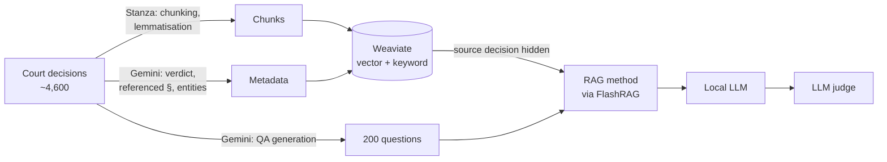
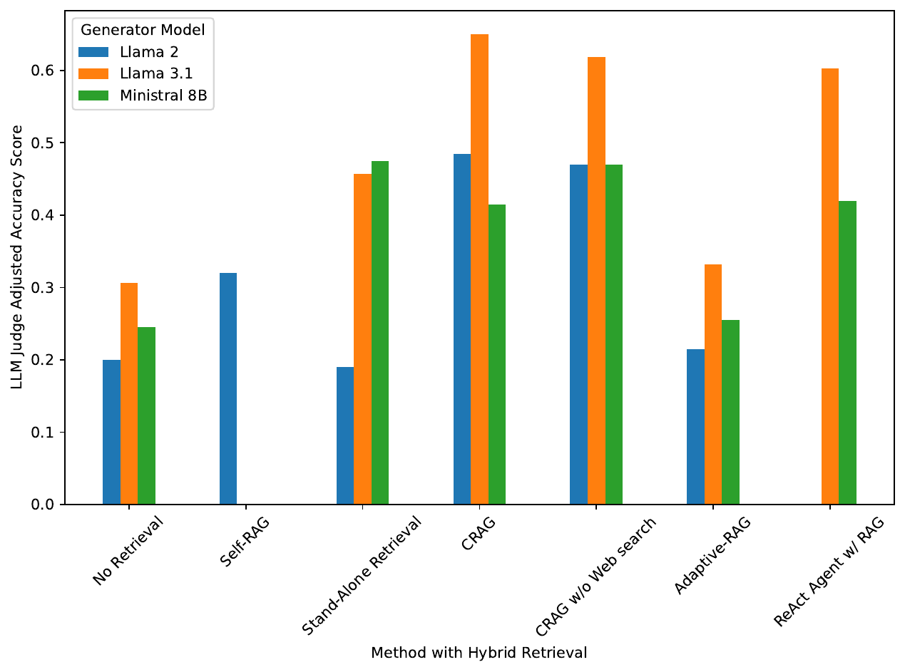
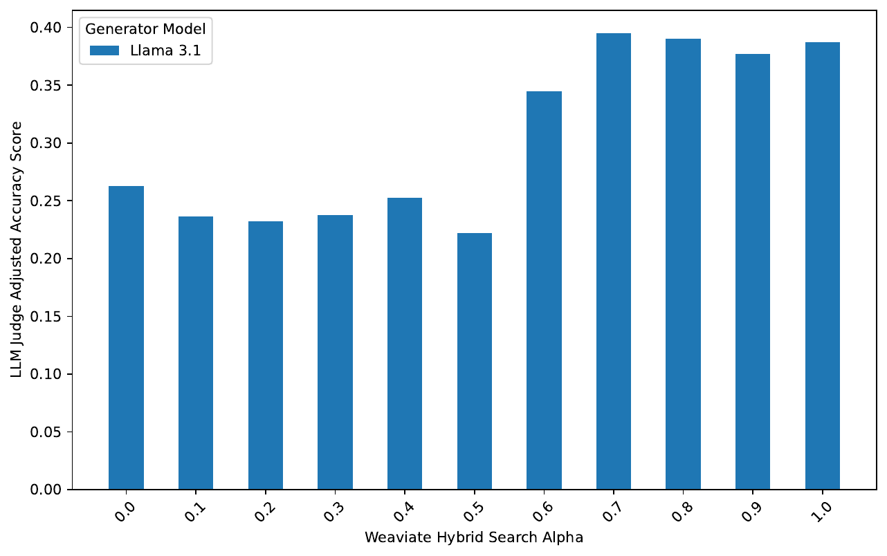

# Local RAG for Czech Court Decisions

Code for my master's thesis, *Local Retrieval Augmented Generation with Large Language Models on Extensive Text Corpora* (FIT ČVUT, 2025, supervised by Alexander Kovalenko).

The thesis compares RAG methods (Corrective RAG, Self-RAG, Adaptive-RAG and a ReAct agent) using small LLMs (7–8B) running locally. It then applies them to decisions of the Czech Supreme Administrative Court, using a hybrid search setup I built for Czech legal text.

On 200 legal questions, Llama 3.1 8B with Corrective RAG answered **61.8%** correctly, compared to **30.7%** without retrieval. Answers were scored by an LLM judge. As a rough upper bound, Llama 3.1 reached 77.5% when the source decision was left in the index.

[Thesis PDF](https://hdl.handle.net/10467/122664) · [Dataset on Hugging Face](https://huggingface.co/datasets/kucerj56/czech-sacd-legal-questions) · [FlashRAG fork](https://github.com/jakub-kucera/FlashRAG) · [CRAG benchmark fork](https://github.com/jakub-kucera/CRAG-v4-dev)

## What I built

- **Dataset.** I scraped about 4,600 published decisions from [sbirka.nssoud.cz](https://sbirka.nssoud.cz). Gemini 2.0 Flash then generated 200 question–answer pairs from them and extracted metadata from each decision: verdict, referenced paragraphs and referenced entities. The questions are on [Hugging Face](https://huggingface.co/datasets/kucerj56/czech-sacd-legal-questions).
- **Retrieval.** Decisions are split into sentence chunks and lemmatised with Stanza, since Czech inflection hurts plain keyword search. Weaviate then combines vector search (multilingual-e5) with BM25F keyword search over the lemmas and metadata.
- **Evaluation.** Each question was generated from one decision. That decision is hidden from the index while the question is answered, so the model has to rely on other decisions. Answers are generated locally (Ollama / vLLM) and graded by an LLM judge that I added to FlashRAG.



## Results

Share of questions answered correctly, as graded by the LLM judge. All methods use the same hybrid retrieval with the source decision hidden.

| Method | Llama 3.1 8B | Ministral 8B | Llama 2 7B |
|---|---|---|---|
| No retrieval | 30.7% | 24.5% | 20.0% |
| Single retrieval step | 45.7% | 47.5% | 19.0% |
| Corrective RAG, no web search | 61.8% | 47.0% | 47.0% |
| Corrective RAG with web search | 65.0% | 41.5% | 48.5% |
| ReAct agent | 60.3% | 42.0% | – |
| Adaptive-RAG | 33.2% | 25.5% | 21.5% |
| Self-RAG (its own Llama 2 7B) | – | – | 32.0% |

The web search in Corrective RAG didn't find relevant documents for these questions. The gap between its two variants is most likely noise. Llama 2 can't use tools, so there's no ReAct result for it.



Other things I found while tuning the retrieval:
- Weighting the hybrid search towards vectors (α ≥ 0.7) worked clearly better than keyword-heavy settings. Above that, the difference from pure vector search was small. The final runs use α = 0.8.
- Adding the referenced paragraphs and entities to both the search and the prompt helped.
- Retrieving more than 5 passages didn't help.
- With dot-product distance on unnormalised embeddings, the α weighting had almost no effect. Switching to cosine fixed this.



The thesis also compares these methods on HotpotQA, 2WikiMultihopQA, ELI5, ARC, MMLU and Meta's CRAG benchmark (chapter 6).

## Repositories

| Repo | Contents |
|---|---|
| this one | `SACD/`: scraping, chunking, lemmatisation, metadata extraction, question generation. `CRAG/`: converting Meta's CRAG benchmark to FlashRAG format. `FlashRAG/`: result processing and analysis notebooks |
| [FlashRAG fork](https://github.com/jakub-kucera/FlashRAG) | Weaviate hybrid retriever, hiding the source decision during retrieval, LLM judge metric, ReAct agent pipeline, separate generation and evaluation runs ([changes](https://github.com/jakub-kucera/FlashRAG/compare/4a6b904...main)) |
| [CRAG fork](https://github.com/jakub-kucera/CRAG-v4-dev) | Separate generation and evaluation, with local models as judges ([changes](https://github.com/jakub-kucera/CRAG-v4-dev/compare/c71ad61...main)) |

## Running it

The experiments ran on the FIT ČVUT GPU cluster. [`README-example-run.MD`](README-example-run.MD) has my notes on downloading models, building indexes, running Weaviate and submitting Slurm jobs. A single experiment from the FlashRAG fork:

```bash
python examples/methods/run_exp_split.py --method_name crag-leave-1-out \
    --dataset_name nss_v2 --split test --gpu_id 0
```

## License

The code is under the [MIT license](LICENSE). The data files keep the licences of their sources. `CRAG/flashrag_format_data/` is derived from Meta's [CRAG benchmark](https://github.com/facebookresearch/CRAG) (CC BY-NC 4.0). `SACD/flashrag_format_data/sacd_questions.jsonl` is the [Hugging Face dataset](https://huggingface.co/datasets/kucerj56/czech-sacd-legal-questions) (CC BY 4.0).

## Citation

```bibtex
@mastersthesis{kucera2025localrag,
  author = {Ku{\v{c}}era, Jakub},
  title  = {Local Retrieval Augmented Generation with Large Language Models on Extensive Text Corpora},
  school = {Czech Technical University in Prague, Faculty of Information Technology},
  year   = {2025},
  url    = {https://hdl.handle.net/10467/122664}
}
```
